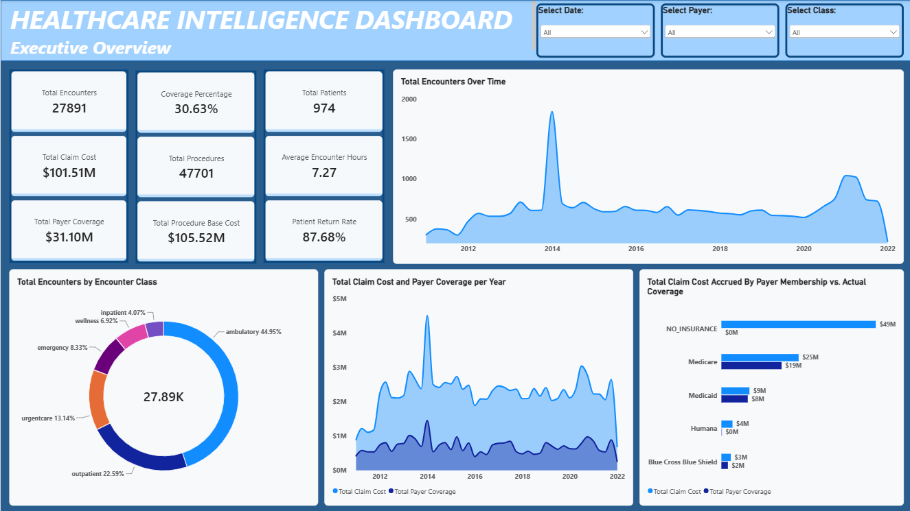

# Hospital_Operations_Cost_And_Patient_Flow_Intelligence_Analysis-Excel-SQL-Power_BI
Healthcare Intelligence Dashboard | SQL + Power BI

  

## Project Files

- [Power BI Dashboard](/hospital_analytics_dashboard.pbix)
- [Dashboard Screenshots](/Week_3_Dashboard.pdf)
- [Healthcare_Analytics_Executive_Report](/Healthcare_Analytics_Executive_Report.pdf)
- [Healthcare_Analytics Methodology](/Healthcare_Analytics_Methodology.pdf)
- [MySQL script](/Week_3_MySQL_Script.sql)
  

## Project Overview

This project analyzes healthcare encounter, procedure, patient, payer, and organizational data to identify trends in healthcare utilization, financial performance, operational efficiency, and patient return behavior.

The interactive dashboard was built using MySQL for data preparation and analysis and Power BI for dashboard development and visualization. Excel was used to inspect the data and correct formatting issues in the CSV files.

## Project Objectives

The project sought to answer the following business questions:

- How have encounter volumes changed over time?
- Which encounter classes generate the highest costs?
- How much of healthcare expenditure is covered by payers?
- Which procedures contribute most significantly to activity and costs?
- What proportion of encounters last longer than 24 hours?
- How often do patients return for additional healthcare services?

## Tools Used

### MySQL

- Data import and storage
- Data quality assessment
- SQL analysis
- KPI validation

### Excel
- CSV inspection
- Formatting correction

### Power BI

- Data modeling
- DAX calculations
- Interactive dashboard development
- Business intelligence reporting
- DAX Measures
- Executive Overview

The dashboard provides a high-level summary of:

- Total encounters
- Total patients
- Total procedures
- Total claim costs
- Payer coverage
- Return rates
- Encounters Analysis

It examines:

- Encounter classes
- Claim costs
- Payer coverage
- Average encounter costs
- Procedures Analysis

It analyzes:

- Procedure volume
- Procedure costs
- Procedure duration
- Cost trends

It also investigates:

- Encounter duration
- Long-duration encounters
- Operational efficiency
- Resource utilization
- Patient Returns Analysis

And evaluates:

- Returning patients
- Return rates
- Demographic patterns
- Repeat healthcare utilization

## Key Findings

### Financial Performance
- The hospital recorded 27,891 encounters over an 11-year period.
- Total claim costs exceeded $101.5 million.
- Payer coverage totaled approximately $31 million, resulting in a coverage rate of only 30.6%.
- Uninsured patients generated 48.5% of all claim costs, highlighting a significant financial risk.

### Procedure Utilization
- A total of 47,701 procedures were performed.
- Procedure base costs exceeded $105.5 million.
- The most frequently performed procedure was Assessment of Health and Social Care Needs.

### Operational Performance
- Average encounter duration was 7.3 hours.
- Median encounter duration was only 15 minutes.
- Only 0.27% of encounters exceeded 24 hours, suggesting a small number of long-duration encounters significantly influence average duration.

### Patient Behavior
- 854 of 974 patients recorded multiple encounters.
- Patient return rate reached 87.7%.
- Ambulatory and outpatient services accounted for the majority of returning patients.

### Business Recommendations
- Investigate the financial impact of uninsured patients.
- Evaluate factors contributing to low payer coverage.
- Review long-duration encounters to improve resource allocation.
- Analyze drivers of repeat healthcare utilization.
- Monitor high-cost encounter classes and procedures.

## Project Outcome

The dashboard provides healthcare stakeholders with a centralized view of healthcare activity, financial performance, operational efficiency, procedure utilization, and patient return behavior, supporting data-driven decision-making and highlighting areas where operational and financial improvements may be achieved.

## Conclusion

The findings indicate that the hospital's primary challenges are not related to healthcare demand, but rather to the financial burden associated with uninsured patients, low overall payer coverage, and the resource demands created by recurring patient utilization. Future strategic efforts should focus on improving payment recovery strategies, understanding the causes of repeat encounters, and optimizing the management of high-cost and long-duration healthcare services.

The Healthcare Intelligence Dashboard successfully transformed complex healthcare data into an interactive reporting solution capable of supporting operational and strategic decision-making. By combining SQL-based analysis with Power BI visualizations, the project provides healthcare stakeholders with comprehensive insights into encounter activity, financial performance, procedure utilization, operational efficiency, and patient behaviour.
The resulting dashboard enables users to monitor key performance indicators, identify emerging trends, evaluate financial outcomes, and make more informed decisions based on reliable, data-driven evidence.

## Skills Demonstrated: SQL • ETL • Data Cleaning • Data Validation • Data Modeling • DAX • Power BI • Healthcare Analytics • Data Visualization • Business Intelligence

## Author

Tessy Odiley

## Internship Program

AnalystLab Africa Data Analytics Internship
